<div align="center">

# NEMBA 🧠 ➜ 🗺️ ➜ 🎯

**Neural EMBedding Analysis: turn population activity into maps you can see,
states you can count and behaviour you can decode. On a laptop. No GPU required.**

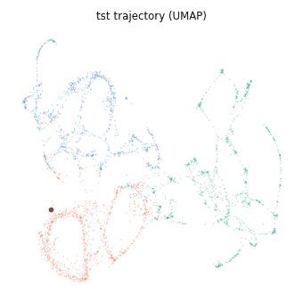

</div>

---

## What is this?

You recorded a lot of neurons (or poses, masks, photometry...). Somewhere in
that blizzard of numbers hide the things you care about: where the animal is,
how fast it runs, which "mode" it is in. NEMBA:

1. **learns an embedding**: a compact, smooth description of what the
   population is doing at each moment (self-supervised, no labels needed);
2. **finds states** in it and tells you how they come and go;
3. **decodes behaviour** from it, *honestly* (held-out time, a permutation
   null, and always next to a no-training baseline);
4. **draws everything**: dashboards, projections, rasters, decoding traces,
   an animated trajectory and an interactive explorer.

Everything runs on a CPU. Your fans may hum; they will not take off.

## ⏱️ The 60-second tour

```bash
# double-click NEMBA.bat           (or: python main.py)  -> the app
python main.py --demo --backbone tcn --speed fast        # synthetic data, known truth
```

```python
from embedders_backbones import Embedder

emb = Embedder("tcn", speed="fast").fit_spikes(spike_times)      # learn the embedding
emb.decode({"x": x, "speed": v, "hd": head_dir},                 # decode on held-out time
           behavior_times=t_beh, circular=["hd"])
emb.run("out", behavior={"x": x, "hd": head_dir},                # figures + tables + explorer
        behavior_times=t_beh, circular=["hd"])
```

No data yet? Leave the file empty in the app (or use `--demo`): NEMBA simulates
60 neurons driven by a **ring phase** (think head direction), a **running speed**
and **three behavioural states**, so you can check that it finds what is really
there. Every picture in this README comes from that demo
(`python docs/make_readme_images.py` regenerates them all).

---

## 🖥️ The app

`NEMBA.bat`, `python main.py`, or **F5** in VS Code ("NEMBA: GUI"). Pick a file
(or nothing for the demo), a backbone, a speed, press **Run**. The window never
freezes: training runs in the background, the progress bar shows each step, and
**Stop** really stops.

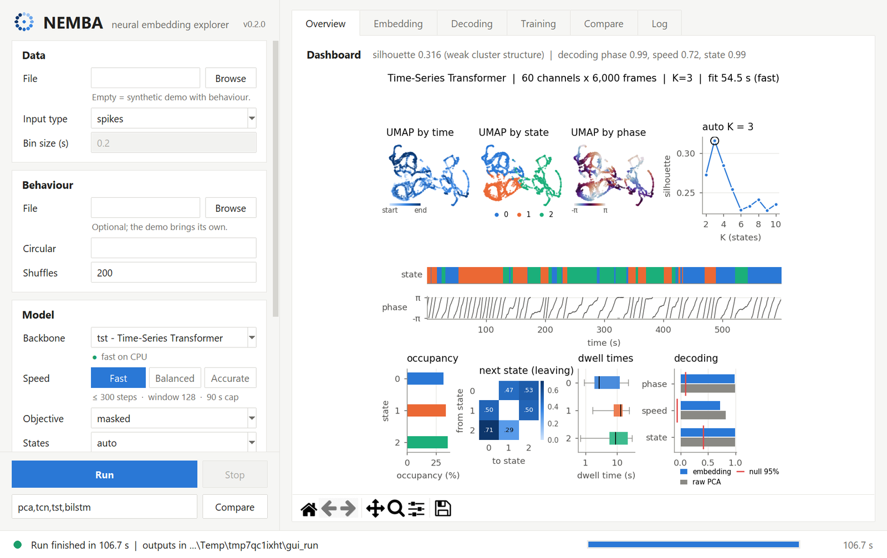

| Tab | What you get |
|---|---|
| **Overview** | the one-page dashboard (below) |
| **Embedding** | projection (UMAP / PCA / t-SNE) coloured by time, state or any behaviour |
| **Decoding** | held-out predictions vs truth + a sortable table of scores and p-values |
| **Training** | loss curves (train and held-out validation) |
| **Compare** | several backbones side by side, with metrics and decoding tables |
| **Log** | everything that happened, in colour |

<table>
<tr>
<td>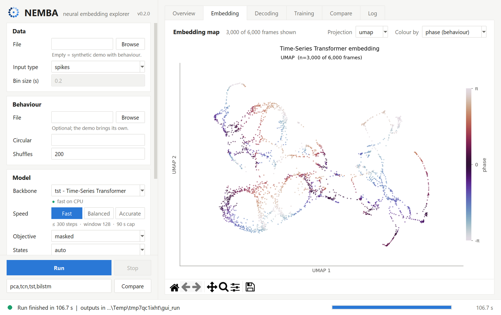<br><sub><b>Embedding</b>: switch projection and colouring live</sub></td>
<td>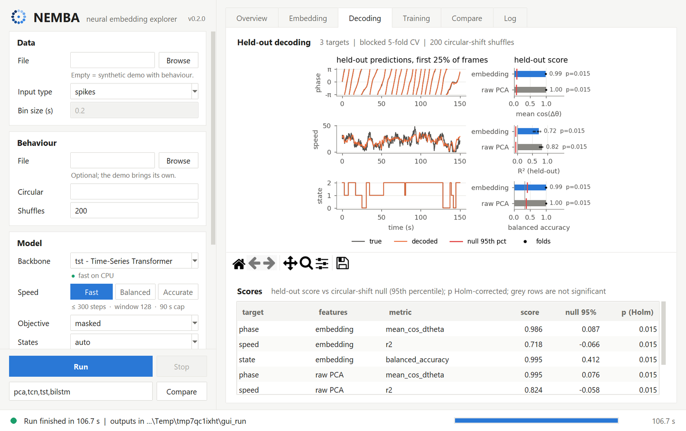<br><sub><b>Decoding</b>: predictions, null test, raw baseline</sub></td>
</tr>
<tr>
<td>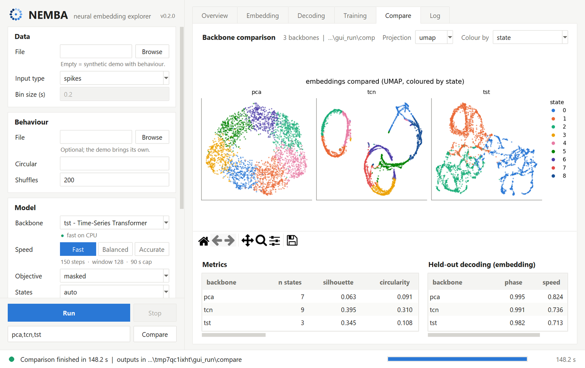<br><sub><b>Compare</b>: which backbone is worth its CPU?</sub></td>
<td>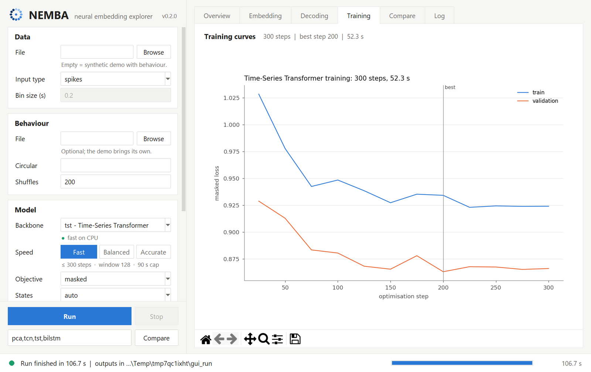<br><sub><b>Training</b>: early stopping on held-out time</sub></td>
</tr>
<tr>
<td colspan="2">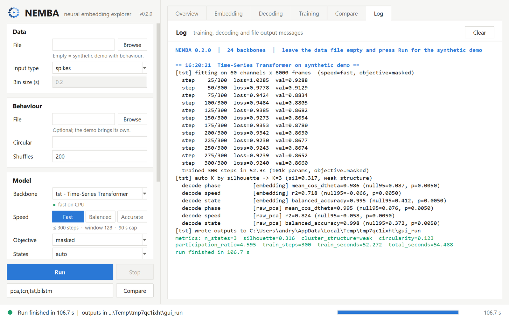<br><sub><b>Log</b>: every step, warning and timing</sub></td>
</tr>
</table>

Handy keys: **Ctrl+R** / **F5** run, **Esc** stop, **Ctrl+O** open a file.
Your last settings are remembered.

---

## 🖼️ What `run()` gives you

### The dashboard: one page, the whole story

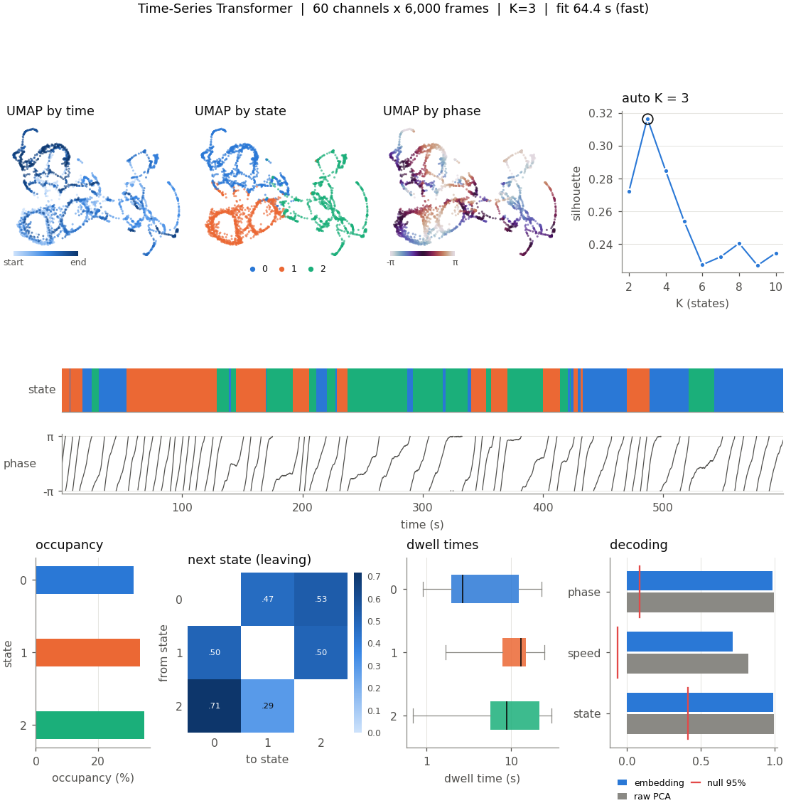

Top: the embedding projected three ways (by time, by discovered state, by a
behaviour) and the curve used to choose the number of states. Middle: the state
sequence lined up with behaviour. Bottom: how much time each state takes, where
it goes next, how long it lasts, and how well each behaviour is decoded.

### Projections

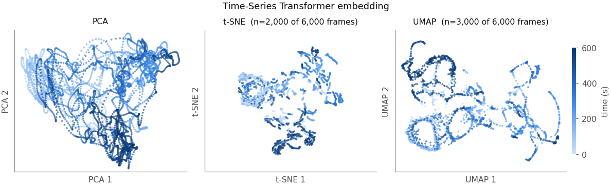
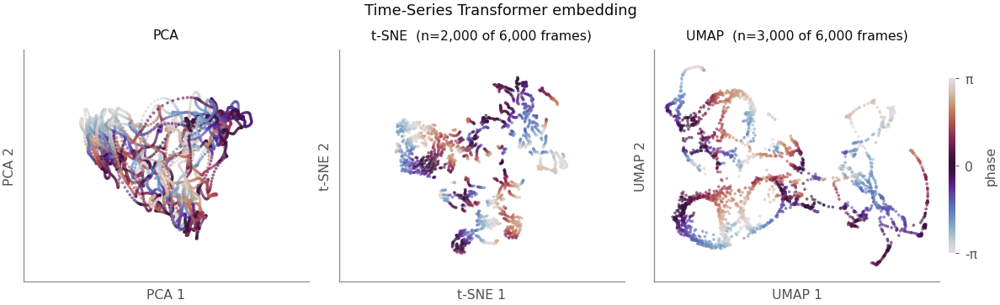

The ring phase comes out as a ring. Angles get a cyclic colour map (so -π and π
look the same, as they should). Slow methods (t-SNE, UMAP) use an evenly spaced
subset of frames, which keeps them fast and keeps trajectories continuous.

### Decoding: can the embedding tell what the animal is doing?

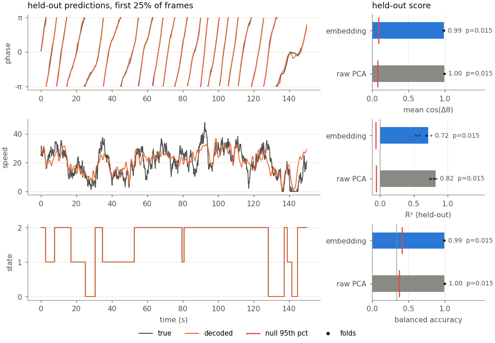

Left: held-out predictions (orange) over the truth (grey). Right: the score of
the embedding (blue) and of the **raw input** (grey, same pipeline), the folds
(dots), and the red tick that chance would only beat 5 % of the time.

### States and their dynamics

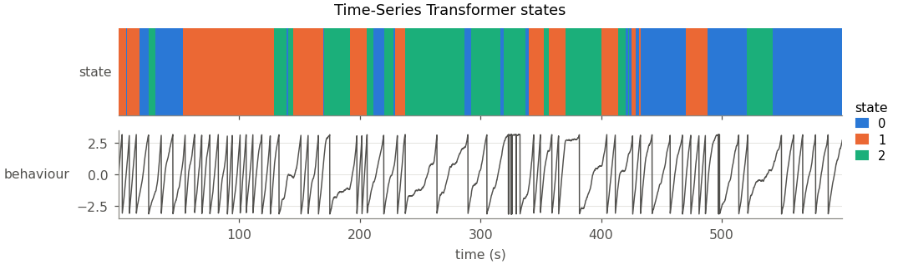
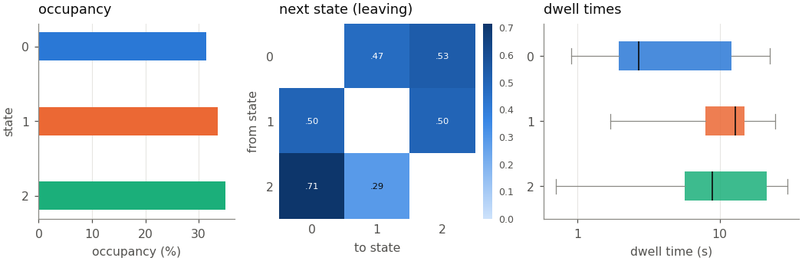

### Training curve

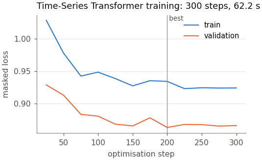

### Interactive explorer (offline HTML)

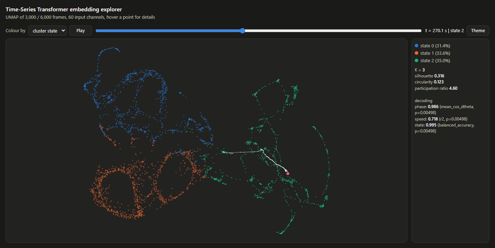

`<backbone>_explorer.html` opens in any browser, no internet needed: hover a
point for its time, state and behaviour, switch the colouring, press Play to
watch the trajectory, toggle light/dark. Share a view with a link hash such as
`explorer.html#color=state&t=0.45`.

### Comparing backbones

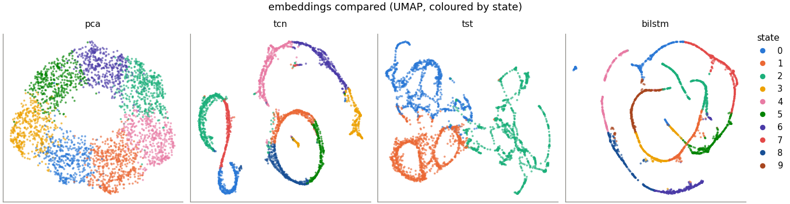
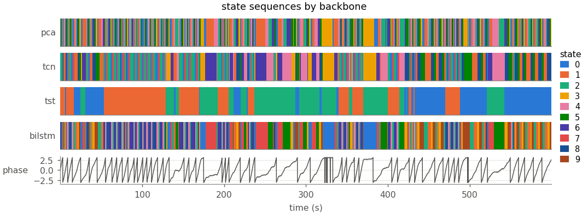

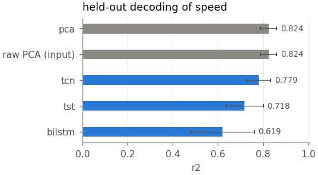 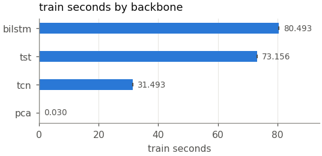

The grey "raw PCA (input)" bar is the baseline every backbone must beat. Spoiler
for the demo: it is hard to beat, see the benchmark.

All figures are saved as **png, pdf and svg**; all numbers as **csv / json**:

| file | content |
|---|---|
| `<bb>_dashboard`, `_embeddings*`, `_decoding`, `_states`, `_state_dynamics`, `_training` | the figures above |
| `<bb>_explorer.html`, `<bb>_trajectory.gif` | interactive explorer, animation |
| `<bb>_decoding.csv` | score, folds, null mean and 95th percentile, p, Holm p, gap, baseline delta |
| `<bb>_metrics.csv/.json`, `_params.json` | geometry metrics, timings, **every setting** |
| `<bb>_k_selection.csv`, `_state_stats.csv`, `_transitions.csv`, `_training_curve.csv` | the numbers behind each panel |
| `<bb>_embedding.npz` | `Z`, `Z_raw`, `states`, `times` |

Figure style lives in one dictionary: `STYLE` in `embedders_backbones/viz.py`.

---

## 🎯 Decoding you can trust

Decoding time series is full of traps. NEMBA steps around them for you:

| trap | what NEMBA does |
|---|---|
| neighbouring frames are near-copies, so random K-fold leaks | **contiguous test blocks** + a **purge gap** on both sides (estimated from the data) |
| shuffling frames makes any two slow signals look related | **circular-shift null**: slides behaviour in time, keeps both autocorrelations |
| testing several variables | **Holm correction** across targets |
| "my deep net decodes X" (so does PCA?) | every target is also decoded from the **raw input**; `delta_vs_raw` is what the encoder adds |
| angles wrap around | circular targets decoded through sin/cos, scored with mean cos(error) and degrees |

Decoders: `linear` (ridge / shrinkage LDA, default), `knn`, `logistic`.
Tip: the smallest possible p is 1/(n_perm + 1) before correction, so use
`n_perm >= 20 x` the number of targets (NEMBA warns you).

---

## ⚡ Speed: no GPU, no problem

| preset | steps | window | width | time cap | for |
|---|---|---|---|---|---|
| `fast` | 300 | 128 | 0.5x | 90 s | exploring, comparing, laptops |
| `balanced` (default) | 1000 | 256 | 1x | 600 s | final embeddings |
| `accurate` | 4000 | 256 | 1x | none | long, fully reproducible runs |

Training stops early when the held-out loss stops improving and keeps the best
checkpoint. Override anything: `Embedder("tcn", speed="fast", max_steps=500,
time_budget_s=None)`. (A time cap makes run time predictable but results
machine-dependent: use `time_budget_s=None` when exact reproducibility matters.)

Under the hood, compared with v0.1:

| | v0.1 | v0.2 |
|---|---|---|
| `import` | 16.3 s | **2.5 s** |
| embedding a whole recording (TCN) | 0.20 s | **0.02 s**, seamless overlap-add |
| spatiotemporal / graph transformers | ~50 min per fit | fused attention + token cap + time budget |
| cost vs recording length | grows with every frame | **fixed step budget** |
| dF/F baseline, 30 min at 1 kHz | hours | **seconds** |
| 4096-pixel mask inputs | crawl | **auto PCA** to 64 components |

---

## 🧩 Backbones

| key | what it is | CPU |
|---|---|---|
| `pca` | **no training at all**, the honest baseline | instant |
| `tcn`, `ed_tcn`, `dilated_tcn`, `ms_tcn`, `ms_tcnpp`, `c2f_tcn`, `stcn`, `c_tcn`, `dc_tcn`, `nac_tcn`, `pit_tcn` | the temporal-convolution family ([details](TCN_VARIANTS.md)) | fast |
| `dwa_tcn` | dynamic-alignment TCN | slow |
| `tst`, `dtc`, `vit`, `enc_crf`, `patchtst`, `embtcn` | transformers (`dtc` adds deep clustering, `enc_crf` a CRF state decoder) | fast to medium |
| `bilstm`, `attn_bilstm`, `rcnn` | recurrent models | fast to medium |
| `stt`, `gatr` | spatiotemporal and graph-attention transformers | slow |

Objectives: `masked` (default: rebuild hidden stretches from context),
`contrastive` (CEBRA-time style: nearby moments close, others far; favours slow
features), `hybrid` (both).

---

## 📊 Benchmark: v0.1 vs v0.2 (and the baseline nobody wants to lose to)

How do you know a refactor made things better and not just different? You
measure. `benchmarks/benchmark_v01_vs_v02.py` simulates recordings where the
truth is known (ring phase, running speed, three states), fits every backbone
with **v0.1** and with **v0.2** (fast and balanced presets; masked, contrastive
and hybrid objectives) and scores *all* embeddings with the *same* judge:

* held-out decoding of phase, speed and state (blocked CV),
* how well K-means on the embedding recovers the true states (ARI / NMI),
* CPU wall time of the fit.

Every (backbone, recording) pair is compared v0.2 vs v0.1; normality of the
paired differences is checked (Shapiro-Wilk) before choosing a paired t-test or
Wilcoxon, with bootstrap confidence intervals, effect sizes and Holm correction.
Results, statistics (CSV) and figures land in
[`benchmarks/results/`](benchmarks/results/).

```bash
python benchmarks/benchmark_v01_vs_v02.py --old <path to a v0.1 checkout>
```

---

## 🍰 Inputs

| data | pass | method |
|---|---|---|
| spike trains | list of spike-time arrays (s) | `fit_spikes` |
| pose (DeepLabCut, SLEAP) | `[features, time]`; NaN gaps are interpolated | `fit_features` |
| COCO segmentation masks | the COCO json | `fit_coco_masks` |
| fiber photometry | signal(s), optional `dff=True` or isosbestic `control=` | `fit_fiber` |
| anything else | `[channels, time]` or `[time, channels]` | `fit_features` / `fit_matrix` |

Behaviour files: `.csv` with a header (a `time` column means "resample onto the
embedding clock"), `.npz` or `.npy`.

Reuse a trained encoder on another session:
```python
emb.save("encoder.pt")
Z_new = Embedder.load("encoder.pt").transform(X_new)     # X_new: [channels, time]
```

## 🤔 Good to know (honest notes)

* **States are only as real as the silhouette says.** On a continuous ring the
  silhouette keeps rising with K and any K is a slicing of the ring. NEMBA reads
  the silhouette for you (none / weak / reasonable / strong, Kaufman & Rousseeuw
  1990) and warns when K hits the upper bound.
* **Always keep `pca` in your comparisons.** If a deep backbone does not beat it
  on held-out decoding, it is not earning its CPU time on your data.
* **Smoothing is a choice** (`smooth_sigma=4` frames by default): great for slow
  variables, blurs fast ones. It is saved in `params.json`.
* What changed and why, with evidence: [`AUDIT.md`](AUDIT.md).

## 🔧 Install

```bash
conda activate analysis                 # any env with Python >= 3.9
pip install -e ".[full]"                # + umap-learn, ripser (nicer projections, topology)
pip install -e ".[coco]"                # compressed COCO RLE masks
```
Or skip installing: `main.py` finds the package by itself. After `pip install`,
the `nemba` command is available.

## ✅ Tests

```bash
python -m pytest -q tests               # ~30 s on a laptop CPU
```
Includes: the masked objective cannot "predict" white noise (the v0.1 leak),
the permutation null is calibrated, and every backbone trains and embeds.
